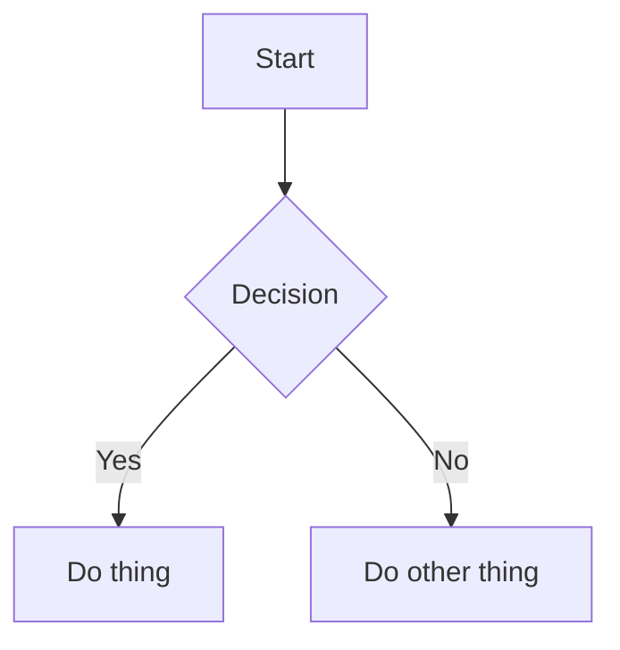
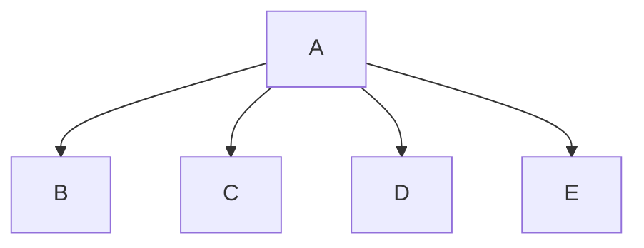

# PSALMS 12

## 12 — THE PURE WORD STAND OUT AGAINST FALSE SPEECH

### Psalm 12 — Combination Mode (7)  
## *Summary + Deep Reading (DR) + PSR*

---

# I. **BKV CHAPTER SUMMARY**
## *The Cry for Truth in a World of Double-Speech*

Psalm 12 is a short, sharp psalm — a cry for help when the world feels full of **smooth words** and **empty flattery**.  
The theme is simple: **When human speech becomes unreliable, the Lord’s words become the only safe ground.**

David sees:
- **The faithful disappearing**  
- **People speaking with divided hearts**  
- **Manipulation disguised as charm**  
- **Boasting tongues claiming autonomy from God**

Into that chaos, the psalm makes a contrast:
**Human speech is slippery.  
God’s speech is pure.**

The Lord responds:  
“I will arise… I will set him in safety.”

Psalm 12 becomes the disciple’s prayer when sincerity feels rare and deception feels normal.  
It is the rediscovery of a single truth:  
**God’s words are silver refined seven times — flawless, steady, and protective.**

---

# II. **BKV–DR (Deep Reading)**  
*A symbolic reading aligned verse-by-verse*

### **vv.1–2 — The Disappearance of the Faithful**
Help, Lord.  
The faithful feel few.  
Truth-tellers fade.  
What remains is double-speech —  
hearts divided, words polished,  
intentions fractured.

### **vv.3–4 — The Tongue as False Power**
May the boasting lips be cut off from their illusions.  
Those who say,  
“Our tongue is our weapon —  
we answer to no one,”  
have forgotten the One  
whose word created their breath.

### **vv.5 — God’s Intervention**
But the Lord rises.  
He hears the sigh of the oppressed.  
He sees the manipulation of the proud.  
He declares:  
“I will lift the vulnerable.  
I will place them where no lie can reach.”

### **vv.6 — The Pure Word**
Human speech corrodes.  
But the Lord’s word is silver —  
refined, purified,  
sevenfold perfection.

### **vv.7–8 — The Closing Reality**
You, Lord, preserve the ones who trust You.  
Even as wickedness walks openly  
and what is worthless is celebrated,  
Your truth remains the sanctuary  
that never collapses.

---

# PSALM 12
## “PURE WORD IN A CROOKED WORLD"

Friend, Psalm 12 feels like it was written yesterday.  
You look around and you see it:  
words are cheap, promises are thin,  
and flattery has become a whole economy.  
People talk big, talk smooth, talk loud —  
but the heart is divided,  
and truth is rare.

And somewhere in the middle of all that noise,  
you feel the ache:  
“Lord… help. Where are the faithful? Where are the honest?”

Here’s the answer of Psalm 12:  
**When the world’s words fail, God rises.**  
Not with propaganda.  
Not with empty slogans.  
But with a Word that is so pure  
it’s like metal refined seven times —  
no dross, no mixture, no lie.

The world says,  
“We decide what is true.  
Our tongues rule us.”  
And God answers,  
“Not so. I hear the oppressed.  
I see the manipulation.  
And I Myself will set My people in safety.”

Psalm 12 is God saying:  
“You can trust Me when you can’t trust them.”  
And for the disciple trying to stay honest in a dishonest age,  
that is strength.  
That is refuge.  
That is hope.

---

# PSALM 12

## “PURE WORD IN A CROOKED WORLD”

I happen to come across psalm 12 today. it is as relevant now as it ever was.
👉🏼  
  
  
  
  
  
  
The people who care about truth seem harder to find.
There's lot of talking, a lot of positionas,
but not much honesty.
The words of the world are all they care for.  
➡ 
  
  
  
  
  
  
They think their words make the rules.
That they decide what’s true just by saying it confidently. Which usually means they are selling a message.
  
And their Satanoc message always is  beleive us, not the Truth.
👉🏼  
  
  
  
  
  
  
So we pray.
And God answers.
  
God says He hears the ones being pushed down.
He sees how language is being used to manipulate.
👉🏼  
  
  
  
  
  
  
  
And He promises to step in and put His people in a safe place.
  
The World's human words break down.
God’s words are dependable and don’t change depending on who’s talking.
👉🏼  
  
  
  
  
  
  
  
  
Friend, let us try to stay honest in this dishonest age.
  
We can't trust what we hear around us.
We can always trust the voice of God. ❤️🙏⚓️  

---

---

flowchart TD
A --> B & C & D & E

---

---

flowchart TD
  A[Start] --> B{Decision}
  B -->|Yes| C[Do thing]
  B -->|No| D[Do other thing]

---

flowchart TD
  A --> B

---

graph TD
  Abraham --> Isaac
  Isaac --> Jacob
  Jacob --> Judah

---

sequenceDiagram
  participant Disciple
  participant Law
  participant Grace

  Disciple->>Law: Attempts alignment
  Law-->>Disciple: Reveals lack
  Disciple->>Grace: Turns inward
  Grace-->>Disciple: Establishes rest

